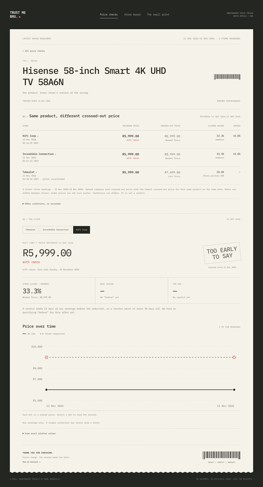

# Trust Me Bru

A small Black Friday price checker for South Africa, by Mark Grenville. A shop says “save 30%”. This project keeps dated price readings so, once it has enough history, it can check the claim.

**The included sample is about sixty products read on one or two nights in November 2026:** 159 readings on 11 November and two test readings early on 12 November. It is not a long-running daily price history.

It looks like a till slip. There is a website, a watchlist of 60 exact products, and a Chrome extension that shows the receipt on a shop’s product page and can collect prices slowly. It runs on your own computer, with no account, database or analytics.

**If you want price history today, use [Buck Cheap](https://buck.cheap).** It has been tracking prices for longer. This is a small experiment, not a replacement.



The screenshot uses only this project’s own observations. The public copy includes our short November 2026 sample, not Buck Cheap’s histories. There is not enough history for saving verdicts yet: claims say **TOO EARLY TO SAY**. Each product and store keeps its latest reading with its original date, so a partial collection does not hide the earlier night. Dates on the slip are reading dates, not live quotes.

## What the numbers mean

- **Claimed saving:** the difference between the shop’s comparison price and its selling price, divided by the comparison price. We keep the shop’s wording: “was”, “Normal Price” or “List Price”. If the page’s code uses a different word, we keep it as a note, not the displayed label. A list price does not necessarily mean the shop ever charged it.
- **What it cost before:** find when the current price began, then take the lowest comparable price in the 30 days **before that reduction**. Using the lowest price since a sale began would count the sale price itself and hide the saving.
- **Real saving:** the reduction from that earlier price. It never goes below zero; a price increase is stated separately in rand and percent.
- **The gap:** claimed saving minus real saving, in percentage points. A 30% claim against a 10% saving has a 20-point gap. These are made-up numbers to explain the calculation.
- **The stamp:** `LEGIT` for a gap of 5 points or less; `MEH` for over 5 up to 15; `TRUST ME BRU` for over 15. A stamp needs at least 14 distinct days of earlier comparable readings. Without a “before”, it says “too early to say”. No saving claimed means no stamp. A price held continuously for 30 days has a reference equal to itself.
- **Spread:** how much higher one store’s comparison price is than the lowest comparison price another store quotes for that same product on the same date. Shops can disagree about this even when their selling prices agree.

Member prices keep their membership condition beside them. Out-of-stock, marketplace and unconfirmed-seller offers are excluded from the store board. Each leaderboard column shows its own sample size; fewer than five qualifying products means “not enough data”. This is a sample of sixty products, not an audit of a retailer.

The maths also supports optional, separately credited tracker reference points. Those histories are **not included** here. Sparse monthly points cannot establish an exact price-change date or a daily low. Tests use fictional reference prices, never copied tracker histories.

## Run the website

You need a recent [Node.js](https://nodejs.org/) installation (version 22 or newer) and Chrome for the extension. No paid service or API key is needed.

1. Download the project: on GitHub, choose **Code → Download ZIP**, then unzip it. If you already have this folder, use it.
2. Open a terminal in the project folder. On macOS, right-click the folder in Finder and choose **Services → New Terminal at Folder** (or open Terminal and change to that folder).
3. Type these commands, one line at a time:

   ```sh
   cd site
   npm ci
   npm run dev
   ```

   The first install needs an internet connection and may take a few minutes. Leave the terminal open while using the site.

4. Open [http://127.0.0.1:3210](http://127.0.0.1:3210) in your browser. Search for a product, open its receipt, compare shops, or look at the **Store board** and **Small print** pages.

Press **Ctrl+C** in that terminal to stop the site. Next time, open a terminal in `site/` and run `npm run dev` again. The site listens only on your own computer. If port 3210 is already in use, stop the other copy before starting this one.

## Load the Chrome extension

Keep the website running, then:

1. Open `chrome://extensions` in Chrome.
2. Turn on **Developer mode** at the top right.
3. Click **Load unpacked** and select this project’s `extension` folder (not `site`).
4. Pin **Trust Me Bru** from Chrome’s extensions menu. Open a shop link from the watchlist or website. Refresh any product page that was already open.

The small receipt appears in the bottom-right corner. Click its heading to collapse it. It shows the latest reading for that exact shop and variant, with its date. An older verdict stays dated; it is never presented as today’s price. An unwatched product says “Not on the watchlist”. Visiting a page alone does not save a price.

Click the extension icon, then **Collect today’s prices**. It opens one background product tab at a time, saves readable prices to your local log and shows progress. You can close the popup while it works. **Stop collection** closes its current tab. **Collection notes** explain skipped offers; **Save collection notes** downloads that record.

The optional **Collect once a day while Chrome is open** switch starts a daily run without another button press. It is off initially. Chrome checks at startup and every 15 minutes; the website must be running. Closed or sleeping Chrome collects nothing. Reload the extension on `chrome://extensions` after changing its files, then refresh open shop tabs.

## Slow, and willing to stop

- At most one product page at a time, with a random 20–30 second minimum interval between visits to the same shop. Slow pages, sleep and browser alarms can make waits longer.
- One saved reading per product, store and South African calendar day. Offers already recorded today are skipped.
- A human check, captcha or block stops that store immediately, for the rest of that day. Three consecutive ordinary failures also stop it. No proxies, fingerprint tricks or captcha solving.
- Only public product pages. No login, account, cart or purchase. Unreadable prices, mismatched barcodes, uncertain stock and unselected variants are skipped, not guessed.

Takealot, Incredible Connection, HiFi Corp, Checkers, Hirsch’s and Pick n Pay are on the watchlist. Makro and Game showed human checks during the initial check, so they are listed as untracked. Store pages change; a reader may need fixing when their layout changes.

## What it cannot tell you

The included observations cover only the dates shown. Missing days stay missing. Fourteen reading days are a smaller sample than a full 30-day record. The site cannot prove a shop’s earlier prices, reconstruct an unseen change, promise that a deal is good, or make a legal finding about a claim.

Exact models, colours, storage, sellers, stock and membership matter. Delivery costs are not included. Grocery prices and availability can depend on an address; no delivery address was selected for the included sample. The first collection also has unconfirmed Takealot sellers, which remain excluded from the board.

The EU’s pre-reduction comparison informed the method; our two-week minimum and missing days fall short of a full application. The Small print page explains the method and its limits. For established history, start with [Buck Cheap](https://buck.cheap); [Serval](https://servaltracker.com) and [PriceCheck](https://www.pricecheck.co.za) are other South African trackers/comparison services. No affiliate links or retailer affiliation.

## Where the data lives

- `data/watchlist.json`: exact products and confirmed shop links.
- `data/observations.jsonl`: our dated readings, one JSON record per line. Collection appends to it.
- `data/stores.json`: tracked stores and reading notes.
- `docs/brief.md`: the product brief.
- `site/`: the website and local API; `extension/`: the ready-to-load extension.

Buck Cheap’s history file, tracker evidence, private project notes, browser logs and local process-manager configuration are omitted from the public copy. The site works when `data/reference-history.json` is absent. No tracker prices are silently filled in. Ordinary product-page visits contact the stores; the extension sends saved readings only to the local site. There are no remote scripts or price uploads to us.

## For people who want to change it

From `site/`:

```sh
npm test
npm run typecheck
npm run build
npm run extension:build
```

Tests cover the maths, missing history, membership, seller handling, ingestion and collection scheduling. The last command regenerates the extension’s reader, manifest and bundled font. Edit `extension/reader-source.cjs`, not the generated `reader.mjs`.

An optional Chrome test uses fixture pages and a disposable local server, never live collection:

```sh
npx playwright install chromium
npm run extension:smoke
```

Its scratch profile, screenshots and logs go into the ignored `.playwright-mcp/` folder. Unit tests write only to temporary files.

## Licence

[MIT](LICENSE), copyright Mark Grenville. The bundled IBM Plex Mono font has its own SIL Open Font License; see [third-party notices](THIRD-PARTY-NOTICES.md). Dependencies retain their own licences.
